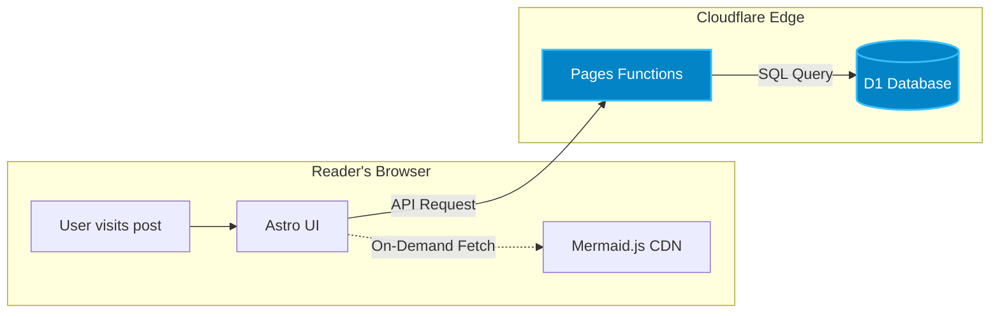
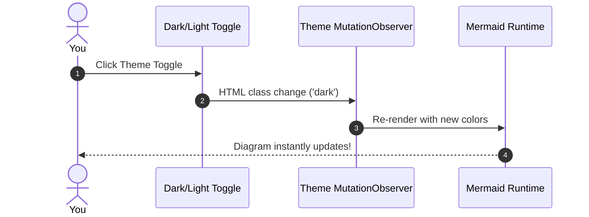
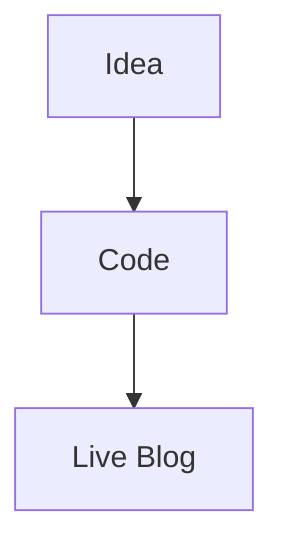

I love visual diagrams in technical posts. A clean flowchart or sequence diagram explains architecture and workflows ten times faster than paragraphs of text.

The problem with diagrams is usually the friction: drawing them in external tools, exporting PNGs/SVGs, uploading them, and then dreading any small architecture change because you'll have to redraw the whole thing.

[Mermaid.js](https://mermaid.js.org/) solves this by letting you write diagrams directly in Markdown code blocks. 

*(Note: If you're looking for a drop-in package for your own site, there is a community integration called [`astro-mermaid`](https://github.com/joesaby/astro-mermaid). I chose to implement a lightweight custom approach directly in my layout instead—giving me zero extra npm dependencies, on-demand CDN loading, tailored Tailwind color palettes, and seamless synchronization with my dark mode toggle and code copy buttons).*

Here is a breakdown of how I designed the solution and how it works under the hood.

---

## Live Demos

First, here are two live diagrams rendered dynamically on this page:

### Architecture Flowchart



### Sequence Diagram: Dark Mode Toggle



---

## The Requirements I Had in Mind

There were three key requirements for the integration:

1. **Zero Bundle Bloat:** Mermaid is heavy (~1MB+ uncompressed). If a post doesn't have diagrams, the browser shouldn't download a single byte of Mermaid.
2. **Instant Dark/Light Mode Reactivity:** Mermaid embeds static inline SVGs with hardcoded hex colors. If someone switches themes, the diagram must update immediately without a page reload.
3. **No Messed Up Copy Buttons:** My blog puts a floating "Copy" button on standard code blocks. Mermaid blocks should render into clean SVG graphics without copy buttons stuck on top of them.

---

## How It's Implemented

Here is the step-by-step approach used in the post layout:

### 1. Check for Mermaid blocks before loading anything

Instead of bundling Mermaid into the static site bundle or using a heavy build plugin, the layout scans the DOM when a post loads:

```javascript
const mermaidBlocks = document.querySelectorAll('pre code.language-mermaid');
if (!mermaidBlocks.length) return; // Exit! Zero JS loaded for standard posts.
```

If there are no diagrams on the page, nothing is downloaded.

### 2. Dynamically import Mermaid from CDN

Only when diagram blocks are present does it fetch Mermaid via modern ES modules:

```javascript
const { default: mermaid } = await import(
  'https://cdn.jsdelivr.net/npm/mermaid@11/dist/mermaid.esm.min.mjs'
);
```

### 3. Initialize theme colors based on current mode

It checks `document.documentElement.classList.contains('dark')` and configures the palette to match the blog's Tailwind theme:

```javascript
const isDark = document.documentElement.classList.contains('dark');

mermaid.initialize({
  startOnLoad: false,
  theme: isDark ? 'dark' : 'default',
  themeVariables: isDark ? {
    background: '#18181b',
    primaryColor: '#0284c7',
    primaryTextColor: '#f4f4f5',
    lineColor: '#94a3b8',
  } : {
    background: '#ffffff',
    primaryColor: '#0284c7',
    lineColor: '#64748b',
  }
});
```

### 4. Render and swap the code block

It iterates through each block, calls `mermaid.render()`, hides the raw `<pre>` tag, and inserts a responsive, horizontally-scrollable wrapper container:

```javascript
for (const pre of uniquePres) {
  const rawCode = pre.innerText;
  const { svg } = await mermaid.render('diagram-' + Date.now(), rawCode);

  const container = document.createElement('div');
  container.className = 'mermaid-diagram-wrapper overflow-x-auto';
  container.innerHTML = svg;

  pre.replaceWith(container);
}
```

### 5. Listen for theme toggles with `MutationObserver`

Because switching between light and dark mode toggles the `dark` class on the `<html>` root, a `MutationObserver` watches for class changes. Whenever the theme changes, it re-renders the diagrams with the new color scheme on the fly:

```javascript
const observer = new MutationObserver((mutations) => {
  for (const m of mutations) {
    if (m.attributeName === 'class') {
      setupMermaidDiagrams();
    }
  }
});

observer.observe(document.documentElement, { attributes: true });
```

---

## Verdict

Now I can just write standard markdown code fences whenever I want a diagram:

````markdown

````

It stays fast, keeps bundle size at zero for text-only posts, and gives me responsive diagrams in both light and dark modes with zero maintenance hassle.
