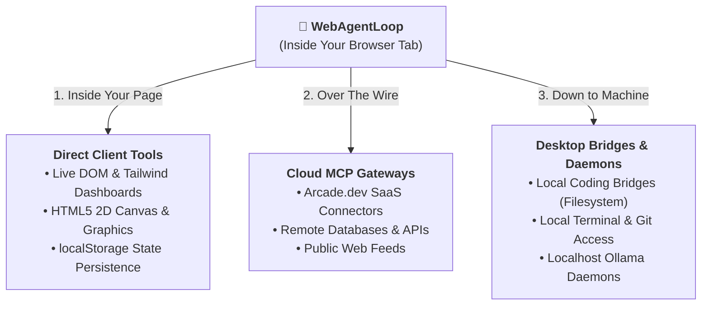

Most AI "agents" today don't actually run where the user is. 

They live on remote Python or Node.js servers, orchestrating expensive headless Chrome browsers in Docker containers or streaming screenshots across high-latency network hops.

We asked a different question:

**What if the agent lives 100% inside the user's browser tab?**

Zero installation, local privacy, and no backend bills. Just a pure TypeScript library running either on local WebGPU or a direct browser-to-cloud API.

The result is [**`@mograblog/web-agent-loop`**](https://www.npmjs.com/package/@mograblog/web-agent-loop). Operating directly inside the client tab unlocks capabilities that server-side agents struggle with—from real-time DOM manipulation and canvas animation to local privacy and infinite extensibility via the Model Context Protocol (MCP).

---

## Try It Out Live in Your Browser

Here is a quick look at `@mograblog/web-agent-loop` running autonomously inside the browser:

<div class="not-prose my-6 rounded-2xl border border-neutral-200 dark:border-neutral-800 bg-neutral-900 shadow-xl overflow-hidden">
  <!-- Replace with your demo video: <video src="/videos/web-agent-demo.mp4" autoplay loop muted playsinline controls class="w-full h-auto"></video> -->
  <div class="aspect-video flex flex-col items-center justify-center p-8 text-center bg-gradient-to-br from-neutral-900 via-neutral-950 to-neutral-900">
    <div class="w-16 h-16 rounded-full bg-indigo-600/20 border border-indigo-500/30 flex items-center justify-center text-indigo-400 mb-4 shadow-lg shadow-indigo-500/10">
      <svg class="w-8 h-8 ml-1" fill="currentColor" viewBox="0 0 24 24"><path d="M8 5v14l11-7z"/></svg>
    </div>
    <p class="text-base font-semibold text-white">Watch WebAgentLoop in Action</p>
    <p class="text-xs text-neutral-400 max-w-md mt-1">Autonomous in-browser ReAct agent fetching live data, building a Tailwind UI, and drawing on canvas.</p>
  </div>
</div>

<div class="not-prose my-6 flex flex-col sm:flex-row items-center gap-4">
  <a href="/demos/web-agent-loop?from=/2026/09/web-agent-loop-autonomous-browser-agents&title=Autonomous+Browser+Agents" class="w-full sm:w-auto inline-flex items-center justify-center px-6 py-3.5 rounded-xl font-bold text-white bg-indigo-600 hover:bg-indigo-500 transition shadow-lg shadow-indigo-500/20 text-base">
    🚀 Launch Fullscreen Interactive Playground →
  </a>
  <a href="https://www.npmjs.com/package/@mograblog/web-agent-loop" target="_blank" rel="noopener noreferrer" class="w-full sm:w-auto inline-flex items-center justify-center px-6 py-3.5 rounded-xl font-semibold text-neutral-800 dark:text-neutral-200 bg-neutral-100 hover:bg-neutral-200 dark:bg-neutral-800 dark:hover:bg-neutral-700 transition text-base">
    View on npm ↗
  </a>
</div>

Want to install it in your own web app?

```bash
npm install @mograblog/web-agent-loop
```

Run an autonomous browser agent in 10 lines of TypeScript:

```ts
import { WebAgentLoop, WebLlmProvider, createCanvasTool, createRenderViewTool } from '@mograblog/web-agent-loop';

// 1. Initialize local on-device neural provider
const provider = await WebLlmProvider.fromModel('Hermes-3-Llama-3.1-8B-q4f16_1-MLC');

// 2. Initialize the loop with built-in browser tools
const loop = new WebAgentLoop({
  provider,
  tools: [
    createRenderViewTool('my-dashboard-container'),
    createCanvasTool(document.getElementById('my-canvas')),
  ],
});

// 3. Listen to live agent thoughts & tool executions
loop.on('thought', (step) => console.log('Thinking:', step.thought));
loop.on('tool_call', (step) => console.log('Calling:', step.toolCall.name));

// 4. Run!
await loop.run('Search for recent news about Tesla and build an interactive dashboard.');
```

---

## 1. The Outcome: What Can a Web-Only Agent Actually Do?

Surprisingly enough, an agent running only on your browser is **unlimited**. 

Because it lives right inside the tab where you are, it can reach in three directions at once:



### 1. Zero Installation, Local Privacy, and $0 Server Costs
- **Zero Installation:** No Python environments, no Docker containers, no CUDA drivers, and no terminal setup. You open a webpage, and the agent runs.
- **Local Privacy:** When running on WebGPU (like Hermes 3 or Llama 3.2), tokens and tool calls execute locally on your graphics chip instead of streaming to remote servers.
- **No Hosting Bills:** Because the client device supplies the compute, you don't have to pay for server GPU clusters.

### 2. Direct into the DOM and Canvas (Live UI & Graphics)
Server-side agents can only stream text or send screenshots back and forth across high-latency webhooks. A web-only agent can directly mutate the user's interface:
- **Instant UI Construction (`render_view`):** The agent generates responsive HTML and Tailwind CSS and paints them directly into your page's DOM. Ask it to *"Search for top tech news and build a dashboard"*, and it renders live metric cards, badges, and read-more buttons in real time.
- **Generative Graphics (`draw_on_canvas`):** It writes and executes JavaScript on an HTML5 `<canvas>`, rendering live procedural particle simulations, interactive data charts, and playable mini-games.
- **Client Persistence (`web_storage`):** It reads and writes directly to `localStorage`, saving preferences, structured notes, and session state without touching a remote database.

### 3. Over the Wire via MCP (Model Context Protocol & Arcade.dev)
Through Anthropic's open Model Context Protocol (MCP) and tool gateways like **Arcade.dev**, the browser agent can connect to external tool servers over standard WebSockets or Server-Sent Events (SSE). It can query remote vector databases, fetch live stock feeds, or invoke authenticated cloud SaaS APIs without requiring your web app to maintain backend server proxy routes.

### 4. Down to Localhost & Desktop Bridges
Because browser JavaScript can make loopback requests to `http://localhost`, the agent can seamlessly bridge to desktop utilities:
- Connect to local developer coding bridges to read, edit, and lint files on your local machine.
- Interact with local terminal bridges.
- Connect directly to local open-weights daemons like Ollama on port 11434.

---

## 2. The Interface: Infinite Extensibility (MCP & Custom Tools)

The true power of an agent is bounded only by the tools you give it. We designed `@mograblog/web-agent-loop` around an open, composable contract: **anyone can extend it as much as they want**.

### A. Including Our Built-In Browser Tools

We built a suite of ready-to-use browser tools that plug into the loop with a single line of code:

```ts
import {
  WebAgentLoop,
  WebLlmProvider,
  createRenderViewTool,
  createCanvasTool,
  createFetchTool,
  createStorageTool,
} from '@mograblog/web-agent-loop';

// Point the tools directly to your page's DOM elements
const tools = [
  createRenderViewTool('my-dashboard-container'),
  createCanvasTool(document.getElementById('my-canvas')),
  createFetchTool(),
  createStorageTool(),
];

const loop = new WebAgentLoop({
  provider: await WebLlmProvider.fromModel('Hermes-3-Llama-3.1-8B-q4f16_1-MLC'),
  tools,
});
```

### B. Adding Your Own Custom Tools in 5 Lines

The interface for defining tools is completely open. Any browser JavaScript logic—whether it accesses the Web Audio API, Geolocation, or custom state in your app—can be wrapped into a `WebAgentTool`:

```ts
import { WebAgentTool } from '@mograblog/web-agent-loop';

// Create a custom tool that generates audio tones in the browser
const toneTool = new WebAgentTool({
  name: 'play_tone',
  description: 'Plays an audible notification beep through the Web Audio API',
  parameters: {
    type: 'object',
    properties: {
      frequency: { type: 'number', description: 'Frequency in Hertz (e.g. 440)' },
      durationMs: { type: 'number', description: 'Duration in milliseconds' },
    },
    required: ['frequency'],
  },
  execute: async ({ frequency, durationMs = 200 }) => {
    const ctx = new AudioContext();
    const osc = ctx.createOscillator();
    osc.frequency.value = frequency;
    osc.connect(ctx.destination);
    osc.start();
    osc.stop(ctx.currentTime + durationMs / 1000);
    return { status: `Tone played at ${frequency} Hz` };
  },
});

loop.registerTool(toneTool);
```

### C. External Adding of MCP (Model Context Protocol & Arcade.dev)

What if you want your browser agent to inspect files on your desktop, run terminal commands, query a remote PostgreSQL database, or interact with Slack and GitHub?

Through Anthropic's open **Model Context Protocol (MCP)**, the browser agent can connect to external tool servers over standard transports (WebSocket or Server-Sent Events):

#### 1. Connecting to Local Desktop MCP Bridges
```ts
import { WebAgentMcp } from '@mograblog/web-agent-loop';

// Connect to an MCP server running on your desktop (e.g. for filesystem or terminal access)
const desktopBridge = new WebAgentMcp({
  name: 'local-coding-bridge',
  serverUrl: 'ws://localhost:8765/mcp',
  transport: 'websocket',
});

await desktopBridge.connect();
loop.registerMcp(desktopBridge);
```

#### 2. Cloud Tool Gateways via Arcade.dev
If you want the agent to interact with authenticated SaaS tools (like searching your GitHub issues, sending Slack notifications, or updating Google Calendar), we included a dedicated connector for **[Arcade.dev](https://arcade.dev)**:

```ts
import { createArcadeMcp } from '@mograblog/web-agent-loop';

// Connect to Arcade's unified MCP gateway with your API key
const arcade = createArcadeMcp({
  apiKey: 'arc_...',
});

await arcade.connect();
loop.registerMcp(arcade);
```

Arcade manages the OAuth authentication flows and scopes behind the scenes, allowing your browser agent to securely execute real SaaS tools without needing you to write custom auth servers.

In both cases, `WebAgentLoop` automatically queries the MCP server's tool schema, converts its endpoints into native agent tools, and invokes them transparently during execution. Anyone can expose any capability over MCP and plug it into the in-browser agent in seconds.

---

## 3. How Do Agents Actually Work? (The Simple Version)

If you strip away all the AI buzzwords, an "agent" is fundamentally just an automated `while` loop:

```ts
while (!taskComplete && steps < maxSteps) {
  const nextStep = await model.decide(history);
  const result = await executeTool(nextStep);
  history.push(result);
}
```

Instead of a human manually copy-pasting outputs, errors, and follow-ups back and forth in a chat box, the program automates the cycle: the model decides on a tool, your browser executes it, hands the result back, and the model decides what to do next.

In modern agent frameworks, this pattern is known as **ReAct** (Reason + Act)—the model reasons about what it needs, executes an action, and observes the result.

### The Hidden Complications

When you use commercial cloud APIs (like OpenAI or Grok), this loop feels almost trivial. The cloud server does the heavy lifting behind the scenes: it formats the tools, intercepts unneeded calls, and returns clean, structured JSON ready to use.

The complications start when you interface directly with local or on-device LLMs (like running open-weights models via WebGPU):
- **Raw token parsing:** The neural network generates raw text tokens, not neat JSON objects. Someone has to scan the text and reliably pull out the tool name and arguments.
- **Chat template discrepancies:** Different open-weights models expect tools formatted in different ways (raw ChatML, special XML tokens, or custom system prompts).
- **Getting it to stop:** Without cloud guardrails, local models often want to keep chaining tools forever unless your runtime steps in and tells them the job is done.

*(What about Ollama? Does Ollama take care of all of this for you on localhost, or does it still leak raw text? Honestly, provider quirks and tool-parsing edge cases could fill an entire article on their own!)*

We handled all of that plumbing under the hood inside `@mograblog/web-agent-loop` so you don't have to worry about it. We won't get bogged down in those low-level weeds in this post—**if you are interested in a dedicated deep dive on provider adapters, ReAct parsing, and client-side loop supervision, let me know in the comments below!**

---

## Summary

Moving AI agents from remote server clusters directly into the browser changes the equation. When an agent lives inside your tab, the web itself becomes its operating canvas.

With direct DOM rendering, interactive canvas generation, and seamless extensibility via MCP and custom tools, `@mograblog/web-agent-loop` delivers a truly autonomous, private, and zero-server-cost agent runtime for the modern web.

Give it a spin on the [**Fullscreen Playground**](/demos/web-agent-loop?from=/2026/09/web-agent-loop-autonomous-browser-agents&title=Autonomous+Browser+Agents), check out [**@mograblog/web-agent-loop on npm**](https://www.npmjs.com/package/@mograblog/web-agent-loop), and let me know in the comments what you build!
